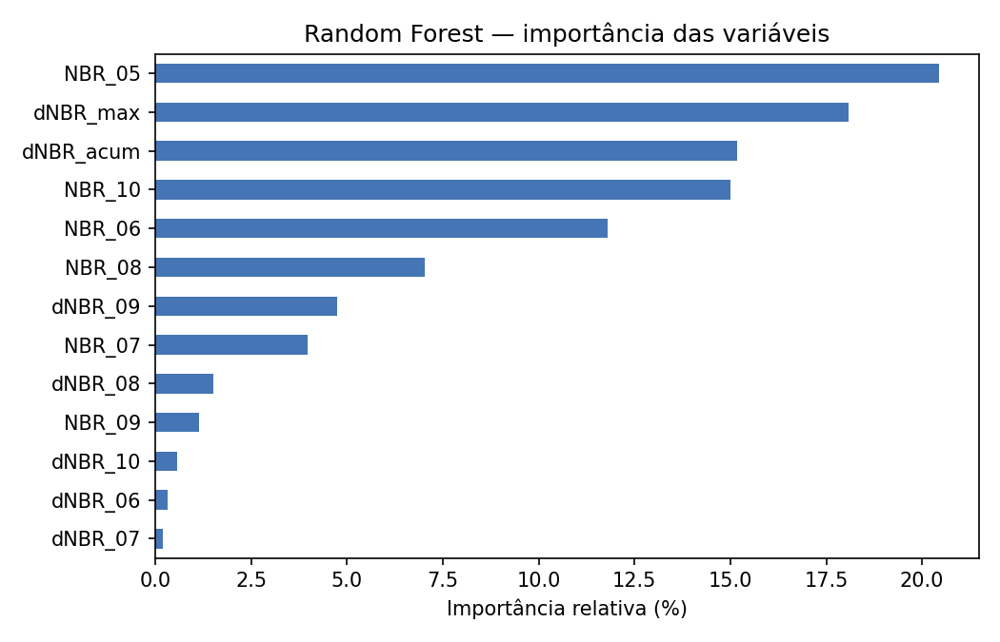
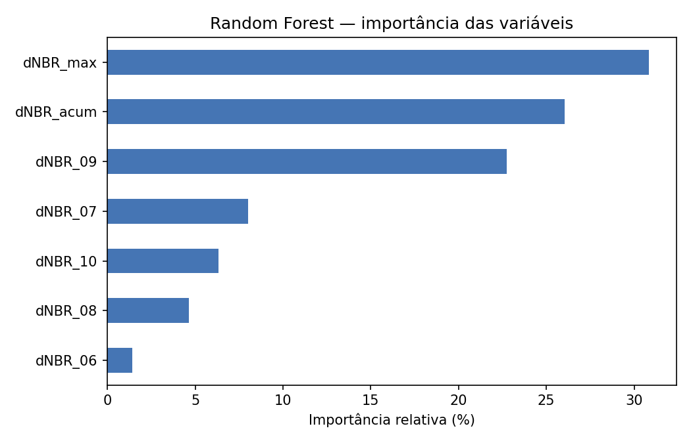
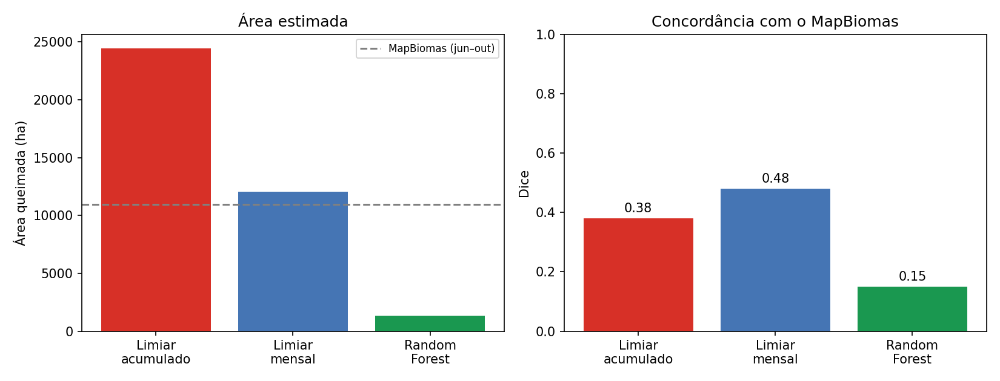

# Área queimada no Parque Nacional da Chapada das Mesas (MA) — estação seca de 2024

**Projeto final (Capstone Project) do Space Tech Bootcamp 2026 — Future Tech Leaders Brasil**

**Autora:** Fernanda Carine Soares Mendes, mestranda em Engenharia Aeroespacial (UEMA)

🌐 **Página do projeto, com mapa interativo:** https://passagens-alt.github.io/area-queimada-chapada-mesas/

Este repositório estima e mapeia a **área queimada mensal e acumulada** no Parque Nacional da Chapada das Mesas (PNCM), no sul do Maranhão, entre junho e outubro de 2024, a partir de **séries temporais de índices espectrais do Sentinel-2** (NBR e dNBR) no Google Earth Engine. O resultado é **validado com o MapBiomas Fogo** e comparado com um classificador **Random Forest**.

| Resultado principal | Valor |
|---|---|
| Área queimada, jun–out/2024 | **12.202 ha (7,6 % do parque)** |
| MapBiomas Fogo, mesmo período | 10.986 ha (6,8 %) |
| Concordância espacial com o MapBiomas (F1 / Dice) | **0,48** |
| Polígonos de área queimada publicados | 4.290 |

---

## Sumário

1. [Introdução e importância](#1-introdução-e-importância)
2. [Revisão da literatura](#2-revisão-da-literatura)
3. [Metodologia](#3-metodologia)
4. [Resultados](#4-resultados)
5. [Deployment](#5-deployment)
6. [Código: estrutura, instalação e reprodução](#6-código-estrutura-instalação-e-reprodução)
7. [Produto final](#7-produto-final)
8. [Limitações e trabalhos futuros](#8-limitações-e-trabalhos-futuros)
9. [Referências](#9-referências)
10. [Créditos](#10-créditos)

---

## 1. Introdução e importância

### Ideia do projeto
O fogo é recorrente no Cerrado do sul do Maranhão. Em setembro de 2024, um grande incêndio atingiu o Parque Nacional da Chapada das Mesas, unidade de conservação de cerca de 160 mil hectares. O monitoramento mais divulgado usa **focos de calor**, que mostram onde houve fogo ativo, mas não quanto de área foi queimada nem como essa área se acumula ao longo da estação seca.

- **Problema:** falta, para essa unidade de conservação, uma estimativa espacialmente explícita e temporalmente detalhada da área queimada.
- **Tarefa:** identificar e mapear as **cicatrizes de queimada** em imagens de satélite, mês a mês, e quantificar sua área.
- **Pergunta científica:** qual foi a extensão da área queimada no PNCM durante a estação seca de 2024 e como ela evoluiu mês a mês?
- **Objetivo:** estimar e mapear a área queimada mensal e acumulada entre junho e outubro de 2024, a partir de séries temporais de índices espectrais do Sentinel-2, e avaliar o resultado contra uma referência independente.

### Relevância para os ODS e para o ecossistema geoespacial
- **ODS 15 — Vida Terrestre (relação principal):** o projeto gera informação para a conservação de um ecossistema protegido do Cerrado e para o acompanhamento da sua degradação pelo fogo.
- **ODS 13 — Ação contra a Mudança Global do Clima (relação secundária):** o monitoramento da área queimada apoia a capacidade de resposta a estações secas severas. O projeto não mede emissões.
- **Contribuição prática:** a série mensal mostra em que meses e setores o parque é mais afetado, o que pode subsidiar a gestão da unidade (ICMBio) e as brigadas no planejamento de prevenção e combate.
- **Ecossistema geoespacial:** um fluxo aberto e reprodutível, baseado apenas em dados gratuitos (Copernicus, Google Earth Engine, MapBiomas), que pode ser repetido em outros anos e unidades de conservação.

## 2. Revisão da literatura

O **NBR (Normalized Burn Ratio)** e a sua diferença entre duas datas, o **dNBR**, são a base da avaliação de áreas queimadas por satélite descrita por **Key e Benson (2006)** no sistema FIREMON. O índice explora o fato de que a vegetação sadia reflete muito no infravermelho próximo e pouco no infravermelho de ondas curtas, e que a queima inverte essa relação. As faixas de dNBR propostas nesse trabalho foram calibradas para **severidade** em ecossistemas dos Estados Unidos. Por isso, neste projeto, o índice é usado para **extensão** e o limiar é examinado localmente, em vez de adotar as tabelas originais.

**Alencar et al. (2022)** descrevem o mapeamento **mensal** de cicatrizes de fogo em todos os biomas brasileiros com imagens Landsat e aprendizado profundo, base do **MapBiomas Fogo**. É hoje a principal referência nacional de área queimada e, por isso, foi usada aqui como **produto de referência independente** para a validação. Por ser nacional e com resolução de 30 m, ele não se propõe a detalhar uma única unidade de conservação com Sentinel-2 (20 m), que é o recorte deste projeto.

**Silva, Pestana e Martins (2019)** mapearam cicatrizes de queimada **mês a mês** (maio a setembro de 2018) no Parque Estadual do Mirador, também no Cerrado maranhense, usando NBR e limiarização com imagens Landsat 8. É o estudo mais próximo deste projeto. Os autores destacam a necessidade de evitar a **dupla contagem** de cicatrizes que persistem nas cenas seguintes, problema tratado aqui ao atribuir cada pixel a um único mês de queima.

**Silva Junior et al. (2018)** analisaram a **dinâmica das queimadas no Cerrado do Maranhão**, o que contextualiza o fogo como um problema recorrente e espacialmente concentrado na região, e reforça a importância de monitorá-lo em unidades de conservação como o PNCM.

**Lacuna abordada:** não foi encontrada, para o PN da Chapada das Mesas, uma estimativa mensal da área queimada em 2024 com Sentinel-2, validada contra o MapBiomas e com análise explícita da sensibilidade ao limiar e da comparação entre métodos.

## 3. Metodologia

### 3.1 Descrição dos dados

| Dado | Fonte e acesso | Formato | Composição | Finalidade |
|---|---|---|---|---|
| Sentinel-2 MSI L2A | Copernicus/ESA, via Google Earth Engine (`COPERNICUS/S2_SR_HARMONIZED`) | Raster | Reflectância de superfície; bandas B4, B8A (865 nm) e B12 (2190 nm), 20 m | Composições mensais, NBR e dNBR |
| Cloud Score+ | Google, via Earth Engine (`GOOGLE/CLOUD_SCORE_PLUS/V1/S2_HARMONIZED`) | Raster | Nota de céu limpo (0 a 1) por pixel | Máscara de nuvens e sombras |
| Limite do parque | WDPA, via Earth Engine (`WCMC/WDPA/current/polygons`) | Vetor | Polígono do PNCM (160.638 ha) | Recorte da área de estudo |
| MapBiomas Fogo, Coleção 5 | MapBiomas, via Earth Engine (`projects/mapbiomas-public/assets/brazil/fire/collection5/...`) | Raster | Mês da queima e área queimada anual, 30 m | Validação |
| Amostras de referência | Este projeto | GeoJSON | 38 polígonos (18 queimados e 20 não queimados), interpretados visualmente | Calibração e treino do Random Forest |

- **Acesso:** todos os dados de entrada são **públicos e gratuitos**, acessados pelo Google Earth Engine (conta gratuita para uso não comercial). O uso deve seguir os termos de cada provedor e citar as fontes.
- **Dados publicados por este projeto:** os **4.290 polígonos de área queimada** (Shapefile e GeoJSON, com área em hectares e mês da queima) e as amostras de referência estão neste repositório. A publicação em uma plataforma com DOI, como o Zenodo, fica como etapa futura.

### 3.2 Descrição da metodologia (ETL, EDA e engenharia de variáveis)

**Extração (Extract):** filtragem das coleções no Earth Engine pela área do parque e pelo período de maio a outubro de 2024: 222 cenas Sentinel-2.

**Transformação (Transform):**
1. **Limpeza:** remoção de pixels com nota de céu limpo < 0,60 (Cloud Score+).
2. **Composição mensal:** mediana dos pixels válidos de cada mês, recortada pelo limite do parque.
3. **Índices:** `NBR = (B8A − B12) / (B8A + B12)`; `dNBR(mês) = NBR(mês anterior) − NBR(mês)`; `dNBR mensal máximo = máx(dNBR de jun a out)`; `dNBR acumulado = NBR(maio) − NBR(outubro)`.
4. **Pós-processamento:** filtro de conectividade (manchas com menos de 3 pixels conectados, < 0,12 ha, são removidas), atribuição do **mês da queima** (mês com a maior queda de NBR) e **vetorização** em polígonos.

**Carga (Load):** resultados exportados para o Google Drive e para este repositório: tabelas (CSV), figuras (PNG), polígonos (Shapefile e GeoJSON) e notebooks executados.

**Análise exploratória (EDA):**
- **Qualidade:** 36 a 42 cenas por mês; **99,6 % do parque com dado válido em todos os meses** (`qualidade_composicoes.csv`).
- **Distribuição do dNBR:** entre maio e setembro, o histograma **não é centrado em zero** (mediana de 0,09). O parque inteiro perde NBR na estação seca por causa do **ressecamento da vegetação**, e as queimadas aparecem na cauda direita. Essa constatação orientou a escolha do índice mensal e o cuidado com o limiar.
- **Amostras:** os pixels das amostras ficaram perfeitamente separados (não queimado ≤ 0,08; queimado ≥ 0,44 no dNBR mensal máximo), o que mostrou que elas representam apenas os **casos extremos**.

**Engenharia de variáveis (features) para o Random Forest:** 13 variáveis por pixel: `NBR_05` a `NBR_10` (NBR de cada mês), `dNBR_06` a `dNBR_10` (queda de cada mês), `dNBR_acum` e `dNBR_max`. Num segundo teste, apenas as 7 variáveis de mudança.

### 3.3 Seleção e exploração do modelo

**Abordagem principal: séries temporais com limiar sobre índice espectral.**
- **Por que é adequada:** o problema é detectar uma **mudança abrupta** da superfície entre datas sucessivas, e o NBR responde fisicamente à queima. Com uma série mensal, cada pixel pode ser atribuído ao mês em que queimou.
- **Vantagens:** interpretável, simples de reproduzir, sem necessidade de grandes conjuntos de treino e com significado físico claro.
- **Limitações:** sensível ao limiar; confunde secagem forte com queima; usa uma única variável por vez.
- **Variantes comparadas:** dNBR acumulado (maio − outubro) e dNBR mensal máximo.

**Modelo alternativo testado: Random Forest** (`ee.Classifier.smileRandomForest`).
- **Por que foi testado:** é capaz de combinar várias variáveis e aprender regras não lineares, sem que o limiar seja escolhido manualmente. Foi sugerido como alternativa pela orientação do bootcamp.
- **Limitações:** depende da representatividade das amostras e pode aprender correlações espúrias, como foi observado.

**Outros modelos considerados:** composição pelo NBR mínimo (como no MapBiomas Fogo), deixada como trabalho futuro; aprendizado profundo, não adotado por falta de um conjunto rotulado grande o suficiente para o parque.

### 3.4 Treinamento e parâmetros

| Parâmetro | Valor |
|---|---|
| **Limiar (métodos de limiar)** | dNBR > 0,20, fixado a partir do histograma, antes da comparação com o MapBiomas |
| Conectividade mínima | 3 pixels (vizinhança de 8) |
| Máscara de nuvens | Cloud Score+ `cs_cdf` ≥ 0,60 |
| Composição mensal | Mediana |
| Escala de processamento | 20 m |
| **Random Forest: número de árvores** | 100 |
| Random Forest: semente aleatória | 42 |
| Random Forest: amostragem | Estratificada, até 1.000 pixels por classe (175 queimados disponíveis) |
| Random Forest: divisão | 70 % treino / 30 % teste (aleatória por pixel) |
| Random Forest: variáveis | 13 (1º teste) e 7, só quedas de NBR (2º teste) |
| Demais hiperparâmetros | Padrões do Earth Engine (variáveis por divisão = raiz do número de variáveis; sem limite de profundidade) |

Épocas, tamanho de batch, taxa de aprendizagem, otimizador e função de perda não se aplicam: não há rede neural no projeto.

### 3.5 Validação cruzada

**Não foi usada validação cruzada k-fold.** O Random Forest foi avaliado com uma divisão simples treino/teste (70/30), feita **por pixel**. Como pixels de teste e de treino vêm dos mesmos polígonos, essa avaliação é **otimista**: deu 100 % de acurácia.

Por isso, a avaliação principal de todos os métodos foi uma **validação externa independente**, contra o MapBiomas Fogo, sobre o parque inteiro. Foi essa validação que revelou que o Random Forest perdia cerca de 90 % da área queimada. Uma **validação cruzada espacial** (separando polígonos inteiros, ou blocos do parque, entre treino e teste) é recomendada como trabalho futuro.

### 3.6 Avaliação

As métricas foram calculadas pixel a pixel contra o MapBiomas Fogo (queimadas de junho a outubro de 2024), numa grade de 30 m:

| Termo usado no projeto | Métrica equivalente |
|---|---|
| 1 − erro de comissão | **Precisão** |
| 1 − erro de omissão | **Recall** (sensibilidade) |
| Coeficiente de Dice | **F1-score** |

**Matriz de confusão aproximada do método principal** (dNBR mensal máximo, limiar 0,20; em hectares, grade de 30 m):

| | MapBiomas: queimado | MapBiomas: não queimado |
|---|---|---|
| **Este estudo: queimado** | ~5.570 (VP) | ~6.490 (FP) |
| **Este estudo: não queimado** | ~5.410 (FN) | restante do parque (VN) |

> O MapBiomas também é um mapa produzido por modelo, e não "verdade de campo". Os números indicam **concordância com uma referência independente**, e não acurácia absoluta.

## 4. Resultados

### Mapa de concordância com o MapBiomas


*Vermelho: os dois mapas indicam queimada. Laranja: só este estudo (comissão). Azul: só o MapBiomas (omissão).*

**Os grandes incêndios são detectados pelos dois produtos** (noroeste, leste e fragmento sul do parque). Em volta de várias cicatrizes aparece azul: este estudo marca o **miolo** das cicatrizes, e o MapBiomas as delimita de forma **mais larga**.

### Série temporal

| Mês (2024) | jun | jul | ago | set | out | **Total** |
|---|---|---|---|---|---|---|
| Este estudo (ha) | 6.612 | 1.637 | 293 | 2.152 | 1.508 | **12.202** |
| MapBiomas (ha) | 2.102 | 2.170 | 807 | 5.012 | 896 | **10.986** |


*Mês da queima: amarelo = jun, verde = jul, verde-azulado = ago, azul = set, roxo = out.*

**A área total ficou a cerca de 11 % da área do MapBiomas, mas em parte porque dois erros sistemáticos se compensam:**
1. **Junho superestimado:** o dNBR de maio para junho inclui o início da secagem da vegetação, que reduz o NBR mesmo sem fogo.
2. **Setembro subestimado:** a composição pela mediana divide entre dois meses uma queimada que ocorre perto da virada do mês. O grande incêndio de 2024 começou no fim de agosto.

### Comparação de métodos e sensibilidade ao limiar

| Limiar | F1: dNBR acumulado | F1: **dNBR mensal máximo** | Área, mensal (ha) |
|---|---|---|---|
| 0,10 | 0,25 | 0,39 | 37.604 |
| 0,15 | 0,31 | 0,47 | 21.764 |
| **0,20** | 0,38 | **0,48** | **12.065** |
| 0,25 | 0,42 | 0,39 | 6.015 |
| 0,30 | 0,40 | 0,25 | 2.668 |


O **dNBR mensal máximo** concordou mais com o MapBiomas em quase todos os limiares: ele detecta a queimada **antes da rebrota** e acumula **menos efeito da secagem**. A área estimada é **muito sensível ao limiar** (de 37.604 a 2.668 ha entre 0,10 e 0,30). O MapBiomas foi usado para escolher **entre os dois métodos**, não para ajustar o limiar.

### Random Forest

| Método | Área (ha) | Precisão | Recall | F1 | Acurácia no teste interno |
|---|---|---|---|---|---|
| Limiar, dNBR acumulado (0,20) | 24.444 | 28 % | 62 % | 0,38 | — |
| **Limiar, dNBR mensal máximo (0,20)** | **12.065** | **46 %** | **51 %** | **0,48** | — |
| Random Forest, 13 variáveis | 2.018 | 61 % | 11 % | 0,19 | 100 % |
| Random Forest, 7 variáveis de mudança | 1.332 | 71 % | 9 % | 0,15 | 100 % |

1. **A acurácia de 100 % no teste interno foi enganosa;** a validação externa revelou que o modelo perdeu cerca de 90 % da área queimada.
2. **No 1º teste, a variável mais importante foi o NBR de maio**, anterior às queimadas. As amostras de queimado estavam concentradas em poucas áreas do parque, e o modelo aprendeu a vegetação dessas áreas (**viés amostral espacial**).

   

3. **No 2º teste, só com as quedas de NBR**, as variáveis passaram a fazer sentido físico (dNBR mensal máximo, dNBR acumulado e a queda de setembro), mas o modelo continuou muito conservador: como as amostras de queimado tinham apenas o miolo das cicatrizes, ele aprendeu que "queimado" é só a queda muito forte.

   



**Conclusão:** um classificador supervisionado só é tão bom quanto as suas amostras. O resultado principal do projeto é o **limiar sobre o dNBR mensal máximo**.

### Etapas exploratórias (notebooks 01 e 02)

| Falsa-cor maio (B12-B8A-B4) | Falsa-cor setembro | dNBR maio → setembro |
|---|---|---|
|  |  |  |

No notebook 02, o limiar foi primeiro escolhido pelas amostras visuais. Como elas estavam perfeitamente separadas, qualquer valor entre cerca de 0,09 e 0,44 acertava todas. Com 0,09, a secagem foi confundida com fogo (27 % do parque); com 0,27, as cicatrizes ficaram fragmentadas (2,8 %). Essa sensibilidade motivou a validação externa do notebook 03.

## 5. Deployment

- **Deployment básico:** todo o código, os dados produzidos e a documentação estão neste repositório público no GitHub.
- **Página web (GitHub Pages):** https://passagens-alt.github.io/area-queimada-chapada-mesas/ , com **mapa interativo** dos polígonos de área queimada (Leaflet), resultados, gráficos, validação e conclusões. O arquivo é `index.html`, na raiz do repositório.

## 6. Código: estrutura, instalação e reprodução

### Estrutura do repositório

| Arquivo | Conteúdo |
|---|---|
| `index.html` | Página do projeto (GitHub Pages) com o mapa interativo |
| `01_area_composicoes_dnbr_teste.ipynb` | Área de estudo, composições mensais, NBR, teste de dNBR e controle de qualidade |
| `02_limiar_e_classificacao.ipynb` | Amostras visuais, escolha do limiar e primeira classificação mensal |
| `03_area_queimada_validacao_mapbiomas.ipynb` | **Classificação final**, série mensal, polígonos, comparação de métodos e validação com o MapBiomas |
| `04_random_forest.ipynb` | Random Forest: engenharia de variáveis, treino, teste, importância e validação externa |
| `poligonos_area_queimada_PNCM_2024_mensal.*` | Polígonos de área queimada (Shapefile: .shp, .shx, .dbf, .prj, .cpg) |
| `poligonos_area_queimada_2024.geojson` | Os mesmos polígonos em GeoJSON (usados pela página web) |
| `amostras_queimado.geojson`, `amostras_nao_queimado.geojson` | Amostras de referência desenhadas |
| `*.csv` | Tabelas de resultados (qualidade, série mensal, sensibilidade, comparação de métodos, Random Forest) |
| `*.png` | Figuras deste README e da página |

### Como instalar as dependências

**Opção 1, recomendada: Google Colab.** Não é preciso instalar nada no computador. Cada notebook instala o que falta na primeira célula (`!pip install -q geemap`); o `earthengine-api`, o `pandas`, o `numpy` e o `matplotlib` já vêm no Colab.

**Opção 2: computador local** (Python 3.10 ou mais recente):
```bash
pip install earthengine-api geemap pandas numpy matplotlib jupyter
earthengine authenticate
```
Nesse caso, as células que usam `google.colab` (montagem do Google Drive) devem ser adaptadas para uma pasta local.

**Em ambos os casos:** é preciso uma conta Google com acesso ao Earth Engine e um **projeto do Google Cloud registrado para uso não comercial** (https://code.earthengine.google.com/register).

### Como executar e reproduzir os resultados
1. Abra os notebooks no [Google Colab](https://colab.research.google.com/), na ordem **01 → 02 → 03 → 04**.
2. Na célula de configuração, troque `PROJETO` pelo ID do seu projeto do Google Cloud.
3. Execute as células **em ordem**, de cima para baixo, sem usar "Executar tudo" nos notebooks 02 e 04, que têm etapas de desenho.
4. O notebook 02 pede que você **desenhe as amostras** no mapa e as salva no Google Drive; os notebooks 03 e 04 leem essas amostras. Para reproduzir exatamente os resultados deste repositório, copie `amostras_queimado.geojson` e `amostras_nao_queimado.geojson` para a pasta `area-queimada-chapada-mesas` do seu Google Drive.
5. Os parâmetros (datas, limiar, máscara de nuvens, conectividade, hiperparâmetros) ficam na **Etapa 1** de cada notebook. No 03, `METODO = 'mensal'` ou `'acumulado'`; no 04, `VARIAVEIS = 'mudanca'` ou `'todas'`.

Os trechos de **preparação dos dados**, **engenharia de variáveis**, **exploração dos modelos**, **treinamento** e **avaliação** estão nos notebooks, com comentários e explicações em português antes de cada etapa.

## 7. Produto final

- **Mapa web (WebGIS)** publicado no GitHub Pages, com os polígonos de área queimada por mês.
- **Relatório:** este README e a página web, com gráficos, resultados, validação e conclusões.
- **Conjunto de dados:** 4.290 polígonos de área queimada no PNCM em 2024 (Shapefile e GeoJSON), com área e mês da queima.

## 8. Limitações e trabalhos futuros

**Limitações**
- Estudo de **uma unidade de conservação em um ano**; validação contra um **produto de referência**, e não contra dados de campo.
- **Comissão em junho**, causada pela secagem da vegetação, e **divisão de queimadas entre meses** pela composição mediana.
- Áreas que queimam cedo e **rebrotam** antes da imagem seguinte podem não ser detectadas.
- Resultado **sensível ao limiar**.
- O projeto mede a **extensão** da área queimada, não a **severidade** nem as **causas** do fogo (incêndio, queima prescrita ou manejo).

**Trabalhos futuros**
- **Agregação temporal de 45 ou 90 dias** (sugestão da orientação do bootcamp), para captar as áreas que queimam no início da estação e rebrotam antes de outubro.
- Composição mensal pelo **NBR mínimo**, para corrigir a divisão de queimadas entre meses.
- Novo **Random Forest com amostras representativas**: espalhadas pelo parque, incluindo casos intermediários, e com **validação cruzada espacial**.
- Repetir a análise para **outros anos** e outras unidades de conservação do Cerrado maranhense.
- Publicar os polígonos com DOI (por exemplo, no **Zenodo**).

## 9. Referências

- ALENCAR, A. A. C. et al. Long-term Landsat-based monthly burned area dataset for the Brazilian biomes using deep learning. *Remote Sensing*, v. 14, n. 11, 2510, 2022. https://doi.org/10.3390/rs14112510
- KEY, C. H.; BENSON, N. C. Landscape Assessment (LA). In: LUTES, D. C. et al. *FIREMON: Fire Effects Monitoring and Inventory System*. USDA Forest Service, RMRS-GTR-164-CD, 2006.
- MAPBIOMAS. *MapBiomas Fogo — Coleção 5*: mapas anuais e mensais de cicatrizes de fogo no Brasil. https://brasil.mapbiomas.org/mapbiomas-fogo/
- SILVA, F. S.; PESTANA, A. L. M.; MARTINS, L. S. Sensoriamento remoto para detecção de queimadas no Cerrado maranhense: uma aplicação no Parque Estadual do Mirador. *Revista Geográfica Acadêmica*, v. 13, n. 2, p. 90–105, 2019.
- SILVA JUNIOR, C. H. L. et al. Dinâmica das queimadas no Cerrado do estado do Maranhão, Nordeste do Brasil. *Revista do Departamento de Geografia*, v. 35, p. 1–14, 2018. https://doi.org/10.11606/rdg.v35i0.142407

## 10. Créditos

- **Autora:** Fernanda Carine Soares Mendes.
- **Orientação no bootcamp:** Emanuel Goulart (Future Tech Leaders Brasil).
- **Assistência de IA:** os notebooks e a página web foram desenvolvidos com apoio de um assistente de IA (Claude, da Anthropic). As decisões de método, a interpretação visual das amostras, a execução e a revisão dos resultados são da autora.
- **Dados:** Copernicus/ESA (Sentinel-2), Google (Cloud Score+ e Earth Engine), UNEP-WCMC/IUCN (WDPA) e MapBiomas (MapBiomas Fogo).
