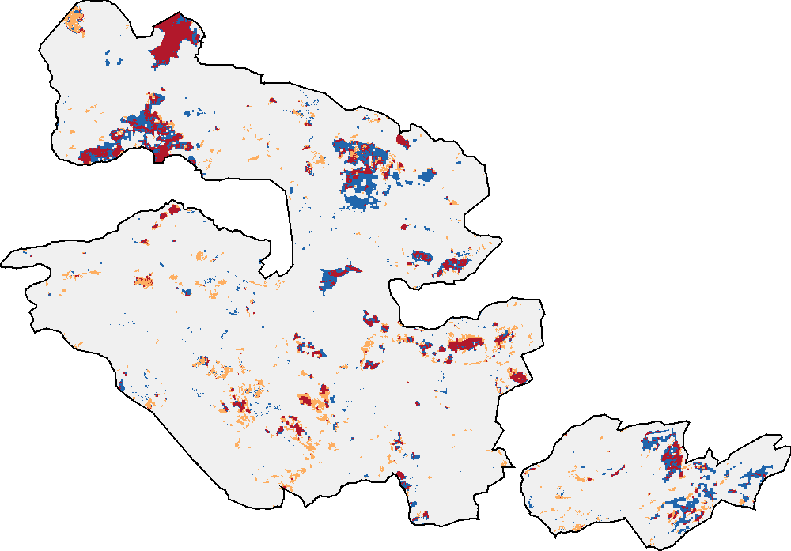
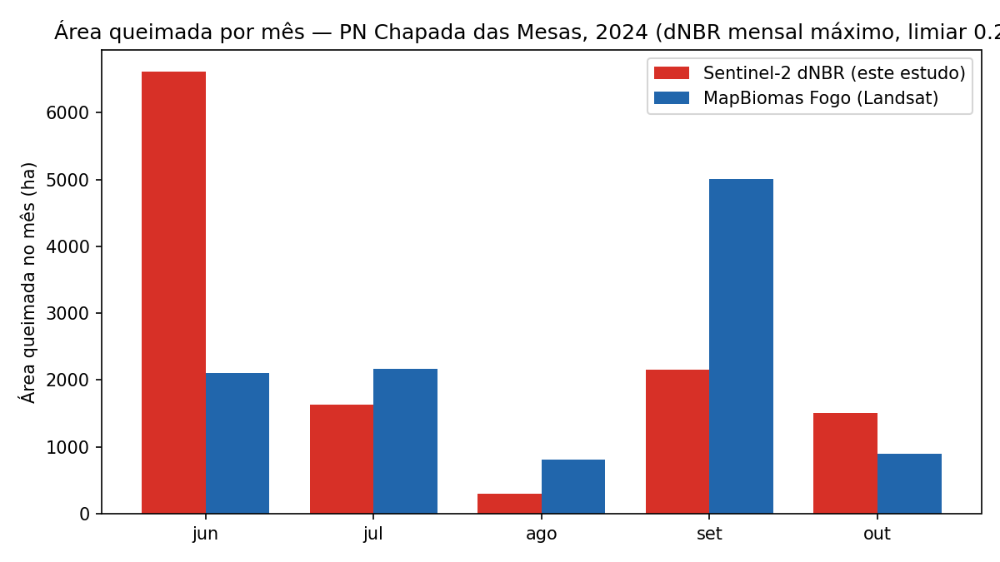
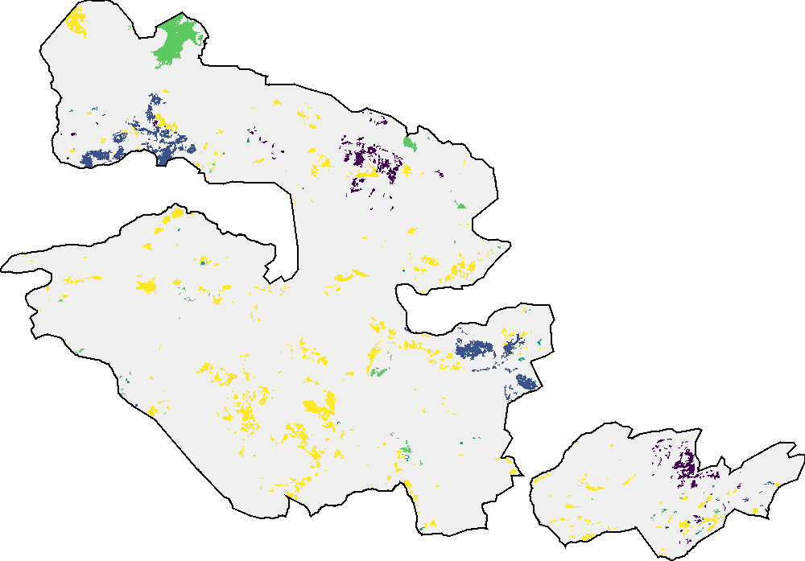
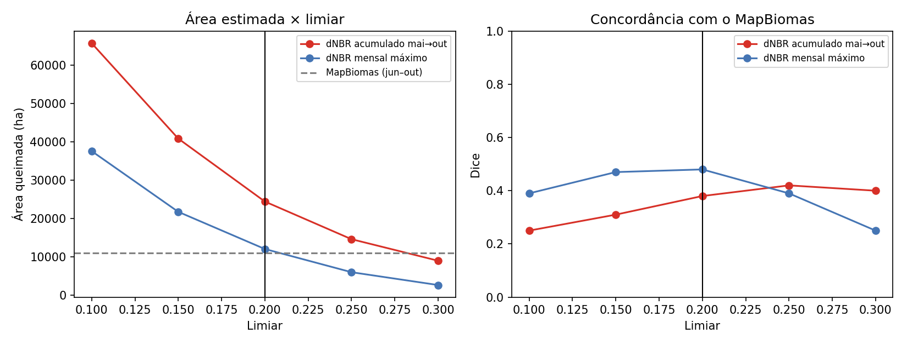
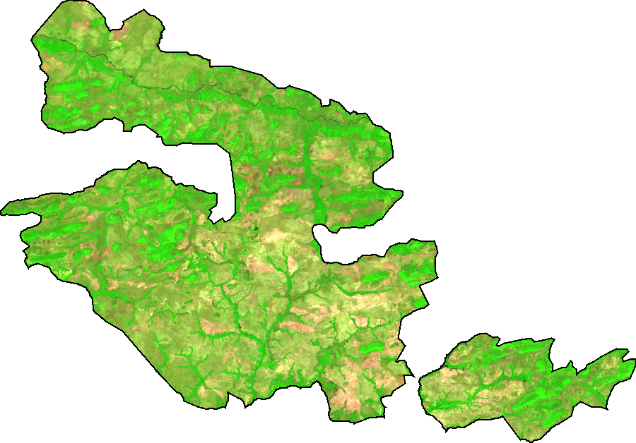
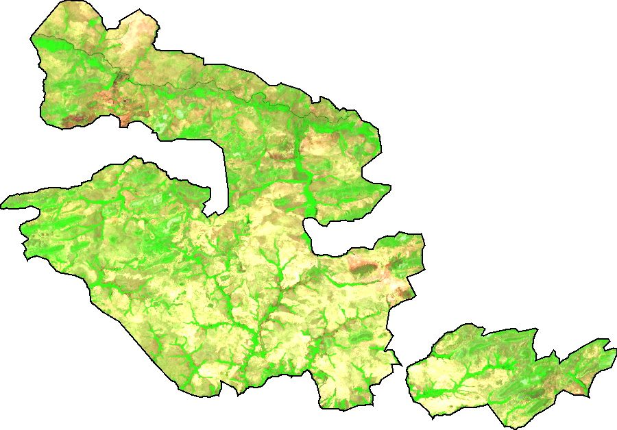
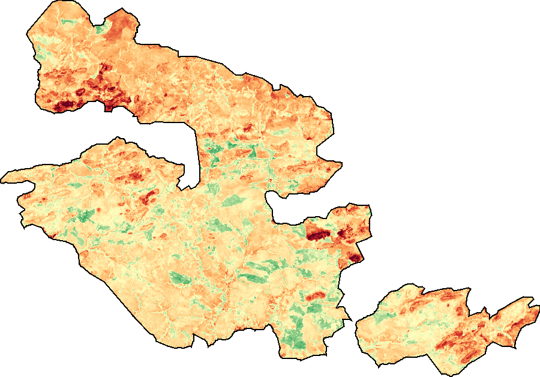

# Área queimada no Parque Nacional da Chapada das Mesas (MA) — estação seca de 2024

Projeto final do **Space Tech Bootcamp 2026 — Future Tech Leaders Brasil**.

Este repositório estima e mapeia a **área queimada mensal e acumulada** no Parque Nacional da Chapada das Mesas (PNCM), no sul do Maranhão, entre junho e outubro de 2024. A análise usa **séries temporais de índices espectrais do Sentinel-2** (NBR e dNBR) no Google Earth Engine e **valida o resultado com o MapBiomas Fogo**.

> **Status (05/11/2026):** análise concluída. Resultados finais com validação abaixo.

---

## Pergunta científica

**Qual foi a extensão da área queimada no PNCM durante a estação seca de 2024 e como ela evoluiu mês a mês?**

Focos de calor mostram onde houve fogo ativo, mas não quanto de área queimou. Este projeto mede a **cicatriz** que o fogo deixa na superfície e acompanha a área queimada ao longo da estação seca.

## Principais resultados

| | Este estudo (Sentinel-2, 20 m) | MapBiomas Fogo (Landsat, 30 m) |
|---|---|---|
| **Área queimada, jun–out/2024** | **12.202 ha (7,6 % do parque)** | **10.986 ha (6,8 %)** |
| Área queimada, ano inteiro de 2024 | — | 16.136 ha (10,0 %) |
| Polígonos de área queimada | 4.290 (maior: 1.043 ha) | — |

**Concordância espacial com o MapBiomas** (jun–out, grade de 30 m): **Dice = 0,48**, omissão = 49 %, comissão = 54 %.

*Vermelho: os dois mapas indicam queimada. Laranja: só este estudo (comissão). Azul: só o MapBiomas (omissão).*

### Série temporal

| Mês (2024) | jun | jul | ago | set | out | **Total** |
|---|---|---|---|---|---|---|
| Este estudo (ha) | 6.612 | 1.637 | 293 | 2.152 | 1.508 | **12.202** |
| MapBiomas (ha) | 2.102 | 2.170 | 807 | 5.012 | 896 | **10.986** |

*Mês da queima: amarelo = jun, verde = jul, verde-azulado = ago, azul = set, roxo = out.*

### Interpretação

- **Os grandes incêndios são detectados pelos dois produtos** (áreas vermelhas no mapa de concordância), incluindo as cicatrizes do noroeste, do leste e do fragmento sul do parque.
- **A área total ficou a cerca de 11 % da área do MapBiomas, mas em parte por compensação de dois erros sistemáticos:**
  1. **Junho superestimado.** O dNBR de maio para junho inclui o **início da secagem da vegetação** do Cerrado, que reduz o NBR mesmo sem fogo.
  2. **Setembro subestimado.** A **composição mensal pela mediana** divide entre dois meses uma queimada que ocorre perto da virada do mês, e em cada um a queda do NBR fica abaixo do limiar. O grande incêndio de 2024 no parque começou no fim de agosto.
- A concordância espacial moderada (Dice 0,48) também reflete as diferenças entre os produtos: resolução (20 m × 30 m), bordas das cicatrizes e os erros do próprio MapBiomas, que também é um mapa produzido por modelo e não "verdade de campo".

## Comparação de métodos e sensibilidade ao limiar

Foram comparados dois índices, ambos com limiar fixo e com a mesma validação:
- **dNBR acumulado:** NBR(maio) − NBR(outubro);
- **dNBR mensal máximo:** a maior queda de NBR entre dois meses seguidos, de junho a outubro.

| Limiar | Dice: dNBR acumulado | Dice: **dNBR mensal máximo** | Área com dNBR mensal (ha) |
|---|---|---|---|
| 0,10 | 0,25 | 0,39 | 37.604 |
| 0,15 | 0,31 | 0,47 | 21.764 |
| **0,20** | 0,38 | **0,48** | **12.065** |
| 0,25 | 0,42 | 0,39 | 6.015 |
| 0,30 | 0,40 | 0,25 | 2.668 |

O **dNBR mensal máximo** concordou mais com o MapBiomas em quase todos os limiares. Ele detecta a queimada **antes da rebrota** e acumula **menos efeito da secagem sazonal** do que o dNBR acumulado, que marcou como queimadas extensas áreas apenas ressecadas.

A tabela também mostra que **a área estimada é muito sensível ao limiar**: entre 0,10 e 0,30, ela varia de 37.604 para 2.668 ha. O limiar de 0,20 foi definido **antes** da comparação com o MapBiomas, com base no histograma do dNBR. O MapBiomas foi usado para escolher **entre os dois métodos**, não para ajustar o limiar.

## Etapas do trabalho

### 1. Área de estudo e qualidade dos dados (notebook 01)
- Limite do parque (WDPA): **160.638 ha**, compatível com a área oficial de cerca de 160 mil ha.
- 222 cenas Sentinel-2 L2A entre maio e outubro de 2024. Após a máscara de nuvens, **99,6 % do parque tem dado válido em todos os meses**.
- No teste de dNBR (maio → setembro), a distribuição dos valores **não está centrada em zero** (mediana de 0,09): o parque inteiro perde NBR na estação seca por causa do **ressecamento da vegetação**, e as queimadas aparecem na cauda direita.

| Falsa-cor maio (B12-B8A-B4) | Falsa-cor setembro | dNBR maio → setembro |
|---|---|---|
|  |  |  |

### 2. Amostras visuais e escolha do limiar (notebook 02)
Foram desenhados **38 polígonos de referência** (18 queimados e 20 não queimados), interpretados visualmente na composição falsa-cor B12-B8A-B4. As amostras ficaram **perfeitamente separadas**: qualquer limiar entre cerca de 0,09 e 0,44 acertava todas. Isso aconteceu porque elas cobriam apenas casos **inequívocos**, e por isso não bastaram para fixar o limiar. Com 0,09, a secagem foi confundida com fogo (27 % do parque "queimado"); com 0,27, as cicatrizes ficaram fragmentadas (2,8 %). Essa sensibilidade motivou a validação externa do notebook 03.

### 3. Classificação final, polígonos e validação (notebook 03)
Classificação final com o dNBR mensal máximo e limiar de 0,20, filtro de conectividade, vetorização e validação com o MapBiomas Fogo.

## Dados

| Dado | Fonte | Uso |
|---|---|---|
| Sentinel-2 MSI L2A (reflectância de superfície) | Copernicus/ESA, via Google Earth Engine (`COPERNICUS/S2_SR_HARMONIZED`) | Composições mensais, NBR e dNBR |
| Cloud Score+ | Google (`GOOGLE/CLOUD_SCORE_PLUS/V1/S2_HARMONIZED`) | Máscara de nuvens e sombras |
| Limite do parque | WDPA (`WCMC/WDPA/current/polygons`) | Recorte da área de estudo |
| MapBiomas Fogo, Coleção 5 (mensal e anual) | MapBiomas (`projects/mapbiomas-public/assets/brazil/fire/collection5/...`) | Validação (referência independente) |

## Método

1. **Composições mensais** (maio a outubro de 2024): imagens com nota de céu limpo ≥ 0,60 (Cloud Score+) e mediana dos pixels válidos de cada mês. Maio é a referência pré-fogo.
2. **Índices espectrais**
   - `NBR = (B8A − B12) / (B8A + B12)`. B8A é o infravermelho próximo (865 nm) e B12 o infravermelho de ondas curtas (2190 nm), ambos com 20 m.
   - `dNBR(mês) = NBR(mês anterior) − NBR(mês)`.
   - `dNBR mensal máximo = máximo de dNBR(jun), …, dNBR(out)`.
3. **Classificação:** pixel queimado se dNBR mensal máximo > **0,20**.
4. **Conectividade:** manchas com menos de 3 pixels conectados (vizinhança de 8), ou seja, menos de 0,12 ha, são descartadas como ruído.
5. **Mês da queima:** o mês com a maior queda de NBR. Assim, cada pixel é contado uma única vez.
6. **Área:** soma da área real dos pixels (`ee.Image.pixelArea()`), em hectares.
7. **Vetorização:** os pixels queimados viram polígonos (Shapefile) com área (ha) e mês predominante.
8. **Validação:** comparação pixel a pixel com o MapBiomas Fogo (queimadas de junho a outubro de 2024), numa grade de 30 m, com erros de omissão e comissão e coeficiente de Dice.

O projeto estima a **extensão** da área queimada, e não a severidade da queima.

## Limitações

- Estudo de **uma unidade de conservação em um ano**.
- A validação usa um **produto de referência** (MapBiomas), e não dados de campo.
- A secagem da vegetação no início da estação seca gera **comissão em junho**.
- A composição pela mediana pode **dividir uma queimada entre dois meses** e subestimá-la.
- O resultado é **sensível ao limiar** (ver tabela de sensibilidade).
- O projeto não identifica as **causas** do fogo (incêndio, queima prescrita ou manejo) nem a **severidade**.

## Trabalhos futuros

- Composição mensal pelo **NBR mínimo** (como no MapBiomas Fogo), para corrigir a divisão de queimadas entre meses.
- Classificação com **Random Forest** treinada nas amostras visuais, incluindo casos difíceis (bordas de cicatrizes e áreas apenas ressecadas).
- Repetir a análise para **outros anos** e para outras unidades de conservação do Cerrado maranhense.

## Arquivos

| Arquivo | Conteúdo |
|---|---|
| `01_area_composicoes_dnbr_teste.ipynb` | Área de estudo, composições mensais, NBR e teste de dNBR |
| `02_limiar_e_classificacao.ipynb` | Amostras visuais, escolha do limiar e primeira classificação mensal |
| `03_area_queimada_validacao_mapbiomas.ipynb` | Classificação final, série mensal, polígonos e validação com o MapBiomas |
| `poligonos_area_queimada_PNCM_2024_mensal.*` | Polígonos de área queimada (Shapefile: .shp, .shx, .dbf, .prj, .cpg) |
| `amostras_queimado.geojson`, `amostras_nao_queimado.geojson` | Polígonos de referência desenhados |
| `resumo_resultados.csv` | Resumo: áreas, omissão, comissão e Dice |
| `serie_mensal_nosso_vs_mapbiomas.csv` | Área queimada por mês (este estudo × MapBiomas) |
| `sensibilidade_e_comparacao_metodos.csv` | Resultados para cada limiar e método |
| `qualidade_composicoes.csv` | Imagens e % de dado válido por mês |
| Arquivos `.png` | Figuras deste README |

## Como reproduzir

1. Tenha uma conta Google com acesso ao Earth Engine e um projeto do Google Cloud registrado para uso não comercial.
2. Abra os notebooks no [Google Colab](https://colab.research.google.com/), na ordem 01 → 02 → 03.
3. Na célula de configuração, confira se `PROJETO` tem o ID do seu projeto do Google Cloud.
4. Execute as células em ordem, de cima para baixo. O notebook 02 pede que você desenhe as amostras no mapa; o 03 lê essas amostras do Google Drive.

Não é preciso instalar nada no computador: o processamento roda na nuvem do Earth Engine.

## Referências

- ALENCAR, A. A. C. et al. Long-term Landsat-based monthly burned area dataset for the Brazilian biomes using deep learning. *Remote Sensing*, v. 14, n. 11, 2510, 2022. https://doi.org/10.3390/rs14112510
- KEY, C. H.; BENSON, N. C. Landscape Assessment (LA). In: LUTES, D. C. et al. *FIREMON: Fire Effects Monitoring and Inventory System*. USDA Forest Service, RMRS-GTR-164-CD, 2006.
- MAPBIOMAS. *MapBiomas Fogo — Coleção 5*: mapas anuais e mensais de cicatrizes de fogo no Brasil. https://brasil.mapbiomas.org/mapbiomas-fogo/
- SILVA, F. S.; PESTANA, A. L. M.; MARTINS, L. S. Sensoriamento remoto para detecção de queimadas no Cerrado maranhense: uma aplicação no Parque Estadual do Mirador. *Revista Geográfica Acadêmica*, v. 13, n. 2, p. 90–105, 2019.
- SILVA JUNIOR, C. H. L. et al. Dinâmica das queimadas no Cerrado do estado do Maranhão, Nordeste do Brasil. *Revista do Departamento de Geografia*, v. 35, p. 1–14, 2018. https://doi.org/10.11606/rdg.v35i0.142407

## Autora

Fernanda Carine Soares Mendes — mestranda em Engenharia Aeroespacial (UEMA).

Orientação no bootcamp: Emanuel Goulart.
