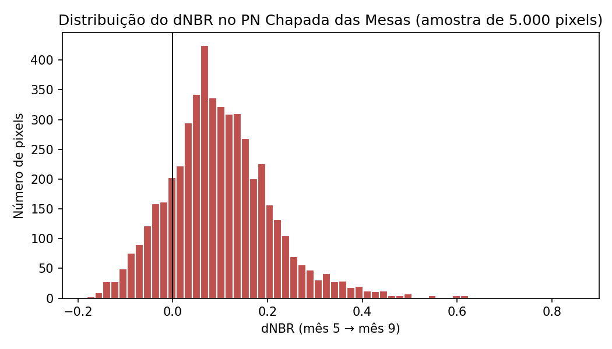

# Área queimada no Parque Nacional da Chapada das Mesas (MA) — estação seca de 2024

Projeto final do **Space Tech Bootcamp 2026 — Future Tech Leaders Brasil**.

Este repositório estima e mapeia a **área queimada mensal e acumulada** no Parque Nacional da Chapada das Mesas (PNCM), no sul do Maranhão, entre junho e outubro de 2024. A análise usa **séries temporais de índices espectrais do Sentinel-2** (NBR e dNBR) no Google Earth Engine.

> **Status (03/11/2026):** etapa 1 de 3 concluída: área de estudo, composições mensais e teste de dNBR. A área queimada ainda **não** foi estimada; isso depende da escolha do limiar (notebook 02).

---

## Pergunta científica

**Qual foi a extensão da área queimada no PNCM durante a estação seca de 2024 e como ela evoluiu mês a mês?**

Focos de calor mostram onde houve fogo ativo, mas não quanto de área queimou. Este projeto mede a **cicatriz** que o fogo deixa na superfície e acompanha como a área queimada cresce ao longo da estação seca.

## Resultados preliminares (notebook 01)

### Área de estudo e qualidade dos dados

- **Limite do parque:** WDPA (polígono "Parque Nacional Da Chapada Das Mesas"), com **160.638 ha**, valor compatível com a área oficial de cerca de 160 mil ha.
- **Imagens:** 222 cenas Sentinel-2 L2A entre maio e outubro de 2024, com nuvens removidas pelo Cloud Score+ (limiar 0,60).

| Mês (2024) | Imagens no mês | % do parque com dado válido |
|---|---|---|
| Maio | 42 | 99,6 |
| Junho | 36 | 99,6 |
| Julho | 36 | 99,6 |
| Agosto | 36 | 99,6 |
| Setembro | 36 | 99,6 |
| Outubro | 36 | 99,6 |

Todas as composições mensais cobrem praticamente o parque inteiro; os 0,4 % restantes correspondem a pixels de borda do polígono. A cobertura de nuvens não limita a análise.

### Teste de dNBR: maio (antes) × setembro (depois)

| Falsa-cor maio (B12-B8A-B4) | Falsa-cor setembro | dNBR maio → setembro |
|---|---|---|
|  |  |  |

No dNBR, tons **vermelho-escuros** indicam queda forte do NBR, compatível com queimada. Há manchas bem delimitadas no noroeste, no leste e no fragmento sul do parque.

Estatísticas do dNBR (amostra de 5.000 pixels): mediana 0,090; quartis 0,031 e 0,161; máximo 0,848.

**Interpretação:** a distribuição não está centrada em zero. O parque inteiro perde um pouco de NBR entre maio e setembro, mesmo onde não queimou, por causa do **ressecamento sazonal da vegetação** do Cerrado. As queimadas aparecem na **cauda direita** da distribuição. Isso tem duas consequências para o método:
1. o limiar de "queimado" precisa ficar acima desse fundo sazonal e será calibrado com amostras locais, e não com tabelas de severidade feitas para outros ecossistemas;
2. a análise final usa o dNBR **mês a mês**, em que o efeito da seca entre duas datas é menor.

## Dados

| Dado | Fonte | Uso |
|---|---|---|
| Sentinel-2 MSI L2A (reflectância de superfície) | Copernicus/ESA, via Google Earth Engine (`COPERNICUS/S2_SR_HARMONIZED`) | Composições mensais, NBR e dNBR |
| Cloud Score+ | Google (`GOOGLE/CLOUD_SCORE_PLUS/V1/S2_HARMONIZED`) | Máscara de nuvens e sombras |
| Limite do parque | WDPA (`WCMC/WDPA/current/polygons`) | Recorte da área de estudo |
| MapBiomas Fogo, Coleção 5 | MapBiomas | Validação (referência independente) |

## Método

1. **Composições mensais** (maio a outubro de 2024): seleção das imagens do mês, remoção de nuvens e composição dos pixels válidos. Maio serve como referência pré-fogo.
2. **Índices espectrais**
   - `NBR = (B8A − B12) / (B8A + B12)`. B8A é o infravermelho próximo (865 nm) e B12 o infravermelho de ondas curtas (2190 nm), ambos com 20 m.
   - `dNBR(mês) = NBR(mês anterior) − NBR(mês)`. Mede a mudança ocorrida em cada mês.
3. **Limiar:** escolhido a partir de amostras de pixels queimados e não queimados, interpretadas visualmente na composição falsa-cor B12-B8A-B4.
4. **Classificação mensal sem dupla contagem:** cada pixel é atribuído ao primeiro mês em que ultrapassa o limiar.
5. **Área e série temporal:** hectares queimados por mês e acumulados.
6. **Validação:** concordância com o MapBiomas Fogo 2024 (erros de omissão e de comissão).

O projeto estima a **extensão** da área queimada, e não a severidade da queima.

## Arquivos

| Arquivo | Conteúdo |
|---|---|
| `01_area_composicoes_dnbr_teste.ipynb` | Área de estudo, composições mensais, NBR, teste de dNBR (executado) |
| `qualidade_composicoes.csv` | Imagens e % de dado válido por mês |
| `falsa_cor_mes05.png`, `falsa_cor_mes09.png`, `dnbr_mes05_mes09.png`, `histograma_dnbr_teste.png` | Figuras do teste |
| `02_limiar_e_classificacao.ipynb` | (a fazer) amostras, limiar e classificação mensal |
| `03_serie_temporal_e_validacao.ipynb` | (a fazer) série temporal e validação com o MapBiomas Fogo |

## Como executar

1. Tenha uma conta Google com acesso ao Earth Engine e um projeto do Google Cloud registrado para uso não comercial.
2. Abra o notebook no [Google Colab](https://colab.research.google.com/) (Arquivo → Fazer upload de notebook).
3. Na célula de configuração, confira se `PROJETO` tem o ID do seu projeto do Google Cloud.
4. Execute as células em ordem, de cima para baixo.

Não é preciso instalar nada no computador: o processamento roda na nuvem do Earth Engine.

## Cronograma (até 20/11/2026)

| Período | Etapa | Situação |
|---|---|---|
| 03–05/11 | Repositório, configuração do Earth Engine, notebook 01 | ✅ concluído em 03/11 |
| 06–09/11 | Amostras visuais e escolha do limiar (notebook 02) | em preparação |
| 10–12/11 | Classificação mensal, áreas e série temporal | a fazer |
| 13–15/11 | Validação com o MapBiomas Fogo (notebook 03) | a fazer |
| 16–18/11 | Figuras finais, README com resultados, slides | a fazer |
| 19/11 | Ensaio da apresentação | a fazer |
| 20/11 | Entrega | — |

## Referências

- ALENCAR, A. A. C. et al. Long-term Landsat-based monthly burned area dataset for the Brazilian biomes using deep learning. *Remote Sensing*, v. 14, n. 11, 2510, 2022. https://doi.org/10.3390/rs14112510
- KEY, C. H.; BENSON, N. C. Landscape Assessment (LA). In: LUTES, D. C. et al. *FIREMON: Fire Effects Monitoring and Inventory System*. USDA Forest Service, RMRS-GTR-164-CD, 2006.
- SILVA, F. S.; PESTANA, A. L. M.; MARTINS, L. S. Sensoriamento remoto para detecção de queimadas no Cerrado maranhense: uma aplicação no Parque Estadual do Mirador. *Revista Geográfica Acadêmica*, v. 13, n. 2, p. 90–105, 2019.
- SILVA JUNIOR, C. H. L. et al. Dinâmica das queimadas no Cerrado do estado do Maranhão, Nordeste do Brasil. *Revista do Departamento de Geografia*, v. 35, p. 1–14, 2018. https://doi.org/10.11606/rdg.v35i0.142407

## Autora

[Seu nome] — mestranda em Engenharia Aeroespacial (UEMA).
